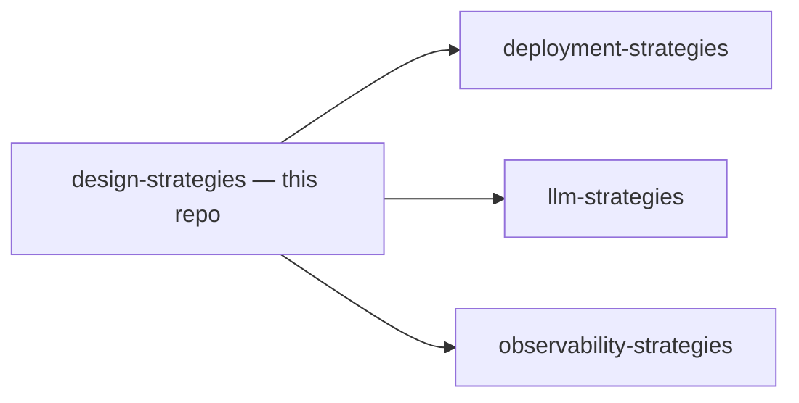

# Design Strategies

**Reference implementation** for **cloud architecture decisions** in multi-agent systems: startup single-region, enterprise multi-tenant, and fintech high-stakes patterns—measured with **synthetic golden workloads** (no live cloud API calls in CI).

Maps to [AI-System-Architecturing-Engineering → design](https://github.com/CaioHAndradeLima/AI-System-Architecturing-Engineering/tree/main/design).

### Where architecture design fits



---

## Strategy comparison

| Strategy | What it models | Prefer when | Trade-off |
|----------|----------------|-------------|-----------|
| `startup_single_region` | Lambda / single-region minimal stack | MVP, cost-first | Weak DR and compliance headroom |
| `enterprise_multi_tenant` | ECS/Cloud Run split, tenant isolation | Growing SaaS | Higher baseline cost |
| `fintech_high_stakes` | Audit, HITL, regulated lanes | Banking / credit agents | Highest cost and complexity |

**Default production baseline:** `enterprise_multi_tenant` until regulated workloads force `fintech_high_stakes`.

---

## Quick start

```bash
python3 -m venv .venv && source .venv/bin/activate
pip install -e .
design-lab evaluate
design-lab evaluate-pipeline --profile ci-design-eval
python -m unittest discover -s tests -v
```

See `docs/PIPELINE_EVAL.md` for CI profile fields.